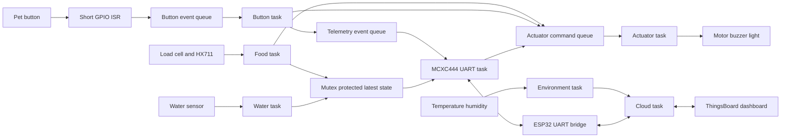

# System design

[Back to project README](../README.md)

## Architecture

The MCXC444 remains responsible for local sensing and actuator deadlines. ESP32 validates environmental readings, evaluates alert limits and publishes directly, reducing UART traffic. Environmental sensing remains available during MCXC444/link failure if ESP32 still has power; cloud reporting also requires internet access.

## RTOS tasks

| Task | Owner | Trigger and responsibility |
|---|---|---|
| FoodSensor_Task | 2 | Periodic, readiness-bounded HX711 reads; calibration/tare/filtering; update state and request feeding |
| WaterSensor_Task | 2 | Periodic ADC reads; low-water interpretation and state update |
| Button_Task | 3 | Block on ISR event queue; debounce, request acknowledgement, enqueue notification |
| Actuator_Task | 1 | Block until a command or next output deadline; own motor/buzzer/light execution |
| UartLink_Task | 4 | Bounded event wait, periodic snapshots and buffered RX processing |
| Environment_Task | 5 | Periodic temperature/humidity reads, validity checks and alert thresholds |
| UartBridge_Task | 4 | Decode local telemetry and forward cloud light commands/results |
| Cloud_Task | 5 | MQTT service, telemetry, commands and bounded reconnect attempts |

Enable pre-emption and time-slicing. Use periodic delays rather than spinning. Actuator deadlines and local button response have priority over bulk telemetry; exact priorities and periods are TODOs to validate on hardware. Network failures must not block environmental sampling or local actuator operation.

Each member implements/tests their owned task entry points. Member 3 creates MCXC444 tasks and shared RTOS objects; Members 4 and 5 coordinate ESP32 task setup. Member 1 owns actuator command handling and deadlines, using Member 3's buzzer/light functions.

## Synchronisation

- Button ISR clears its hardware flag, timestamps the event, uses `xQueueSendFromISR()` and requests a context switch if appropriate for the port. It checks queue-full failure and never debounces, sounds the buzzer or transmits.
- A dedicated button task consumes ISR events. It sends local feedback and owner notifications to separate queues, so UART delays do not hold up acknowledgement.
- Member 3 defines/creates the actuator command queue with Member 1; it carries dispense, buzzer and light requests. The actuator task alone calls output drivers and checks its next deadline even during command bursts.
- The telemetry event queue carries discrete events/results. Sensor readings use a latest-state buffer rather than filling the event queue every sample.
- A mutex protects shared-state updates and brief snapshot copies. Release it before serial/network I/O or waits; never use it in an ISR. ESP32 uses its own local buffers/synchronisation, not the MCXC444 mutex.
- A separate binary semaphore is unnecessary because queues already provide event signalling.

## Module agreements

Names and signatures below are proposed contracts in comments, not implemented declarations. Header templates describe public functions; source templates describe their implementation work.

| Producer to consumer | Contract |
|---|---|
| Food sensing to coordinator | Queue `DISPENSE_REQUEST`; sensing owns confirmed-low-food detection and rearm/minimum-attempt-interval policy |
| Coordinator to dispenser | `Dispenser_Start(now_ms)`, `Dispenser_Update(now_ms)`, `Dispenser_Stop()` and `Dispenser_GetStatus()` |
| Dispenser to coordinator | Busy/completed/failed status; maximum run time is enforced locally |
| Coordinator to feedback | `Feedback_StartCue(cue, now_ms)`, `Feedback_Update(now_ms)`, `Feedback_SetLight(on)` |
| Sensor tasks to shared state | `SharedState_UpdateFood(...)`, `SharedState_UpdateWater(...)`; UART uses `SharedState_CopySnapshot(...)` |
| MCXC444 to ESP32 | Validity-tagged readings, confirmed button events, applied light state and dispense results |
| Cloud to MCXC444 | Light on/off request with request ID; return applied output state, not just receipt acknowledgement |
| Environment to cloud | Temperature, humidity, validity and alert flags; invalid data is not converted to zero |

## Behaviour and open hardware choices

- The load cell measures bowl contents, not proven consumption. Tare requires a known empty bowl and must not blindly zero a full bowl at startup.
- Keep dispensing simple: one bounded request for a confirmed-low condition, then rearm according to an agreed interval/state rule. The work split includes a minimum attempt interval; its value is TODO. Do not add dietary schedules or daily allowances.
- Buzzer cues are short and non-blocking. A completed motor cycle alone does not prove food delivery; use honest result wording unless weight change confirms it.
- The light is an owner-controlled station light. Output confirmation means the commanded GPIO/driver state, not independently measured illumination.
- Water generates a low-level alert only. No pump is in this scaffold.
- Pins, motor type, sensor models, polling periods, thresholds, cue patterns and wire encoding remain implementation TODOs, not invented constants.

## Why FreeRTOS

During dispensing, a button press, sensor deadline and remote light command may arrive together. Tasks with bounded waits keep these activities independent; queues transfer work and a mutex protects snapshots. A non-blocking bare-metal design is possible, but FreeRTOS makes coordination and timing responsibilities explicit. It does not guarantee deadlines without measurement and suitable priorities.
