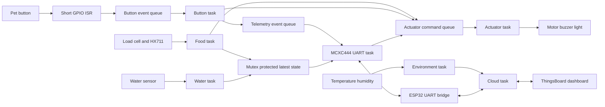

# System design

[Back to project README](../README.md)

## Architecture

The MCXC444 remains responsible for local sensing and actuator deadlines. ESP32 validates environmental readings, evaluates alert limits and publishes directly, reducing UART traffic. Environmental sensing remains available during MCXC444/link failure if ESP32 still has power; cloud reporting also requires internet access.

## RTOS tasks

| Task | Owner | Trigger and responsibility |
|---|---|---|
| FoodSensor_Task | 2 | Periodic, readiness-bounded HX711 reads; calibration/tare/filtering; update state and request feeding |
| WaterSensor_Task | 2 | Periodic ADC reads; low-water interpretation and state update |
| Button_Task | 3 | Block on ISR event queue; debounce, request acknowledgement, enqueue notification |
| Actuator_Task | 1 | Block until a command or next output deadline; own motor/buzzer/light execution |
| UartLink_Task | 4 | Bounded event wait, periodic snapshots and buffered RX processing |
| Environment_Task | 5 | Periodic temperature/humidity reads, validity checks and alert thresholds |
| UartBridge_Task | 4 | Decode local telemetry and forward cloud light commands/results |
| Cloud_Task | 5 | MQTT service, telemetry, commands and bounded reconnect attempts |

Enable pre-emption and time-slicing. Use periodic delays rather than spinning. Actuator deadlines and local button response have priority over bulk telemetry; exact priorities and periods are TODOs to validate on hardware. Network failures must not block environmental sampling or local actuator operation.

Each member implements/tests their owned task entry points. Member 3 creates MCXC444 tasks and shared RTOS objects; Members 4 and 5 coordinate ESP32 task setup. Member 1 owns actuator command handling and deadlines, using Member 3's buzzer/light functions.

## Synchronisation

- Button ISR clears its hardware flag, timestamps the event, uses `xQueueSendFromISR()` and requests a context switch if appropriate for the port. It checks queue-full failure and never debounces, sounds the buzzer or transmits.
- A dedicated button task consumes ISR events. It sends local feedback and owner notifications to separate queues, so UART delays do not hold up acknowledgement.
- Member 3 defines/creates the actuator command queue with Member 1; it carries dispense, buzzer and light requests. The actuator task alone calls output drivers and checks its next deadline even during command bursts.
- The telemetry event queue carries discrete events/results. Sensor readings use a latest-state buffer rather than filling the event queue every sample.
- A mutex protects shared-state updates and brief snapshot copies. Release it before serial/network I/O or waits; never use it in an ISR. ESP32 uses its own local buffers/synchronisation, not the MCXC444 mutex.
- A separate binary semaphore is unnecessary because queues already provide event signalling.

## Module agreements

Most contracts below remain proposals in comment-only templates. The ESP32 environmental interfaces are now implemented in [environment.h](../firmware/esp32/pet_care_station/environment.h), with separate hardware-independent state logic. `Environment_Init()` returns a Boolean initialization result; snapshot consumers check freshness separately. UART/cloud and MCXC444 contracts still require implementation and owner review.

| Producer to consumer | Contract |
|---|---|
| Food sensing to coordinator | Queue `ACT_DISPENSE`, proposed `value = 1` for one portion and `request_id = 0`; sensing owns confirmed-low detection, rearm and minimum interval |
| Coordinator to dispenser | `Dispenser_Start(now_ms)`, `Dispenser_Update(now_ms)`, `Dispenser_Stop()` and `Dispenser_GetStatus()` |
| Dispenser to coordinator | Busy/completed/failed status; maximum run time is enforced locally. `Dispenser_Start()` rejects a request while busy; how often to dispense is food sensing's policy |
| Coordinator to feedback | `Feedback_StartCue(cue, now_ms)`, `Feedback_Update(now_ms)`, `Feedback_SetLight(on)` |
| Sensor tasks to shared state | `SharedState_UpdateFood(...)`, `SharedState_UpdateWater(...)`; UART uses `SharedState_CopySnapshot(...)` |
| MCXC444 to ESP32 | Current: raw water and food milligrams when both are valid, plus button events. Validity/low-water fields and dispense results remain integration work |
| Cloud to MCXC444 | Light on/off request with request ID; return applied output state, not just receipt acknowledgement |
| Environment to cloud | Temperature, humidity, validity and alert flags; invalid data is not converted to zero |

### MCXC444 queue messages (proposed by Member 3, pending review by Members 1, 2 and 4)

Defined in [rtos_types.h](../firmware/mcxc444/app/rtos_types.h). Sensor readings do not use these queues; they use the shared-state buffer.

| Queue | Producer to consumer | Message |
|---|---|---|
| buttonQueue | Button ISR to Button_Task | Tick timestamp of the falling edge |
| actuatorQueue | Button_Task and food logic to Actuator_Task | Command type (beep ack, beep food-ready, dispense), value |
| telemetryQueue | Button_Task to the UART adapter task (`uart_link.c`) | Event type (button pressed), tick |

How the UART module fits (see [MCXC444 UART API](../firmware/mcxc444/communication/README.md)):

- The adapter task calls `sendButton()` for each debounced press and attempts sensor reporting once a second. It copies a shared-state snapshot under the mutex and releases it before UART calls. `sendSensors()` runs only when food and water status are valid; fake-data fallback is disabled. Water is sent as `water_enough = !water.low` (`true` = enough, `false` = low). Water thresholds must be calibrated before reporting. The packet has no validity fields; the ESP32 uses its local receive timestamp to check freshness.
- Remote light commands are not queued. The actuator task polls `consumeLight(&on)` at least every 20 ms and writes the light GPIO immediately; the module sends the ACK itself. The ACK means the command was consumed, not that the light was measured.
- The protocol has no dispense-result message yet, so dispense results are not reported to the ESP32.

Units in shared state: food weight in milligrams (signed 32-bit), water as the raw ADC value (16-bit) plus low-water status and validity. UART sends only the boolean enough-water status, not the raw ADC value.

## Current sensing behaviour

Both sensor tasks are registered in `app/rtos_setup.c` at the proposed sensing priority, with 250 ms periods. Startup checks each sensor's initialization result before creating its task. Sampling periods, stack sizes and priorities require measurement in the actual FreeRTOS project.

- Food uses HX711 GPIO reads on proposed PTB1/PTB3, saved empty-bowl/reference calibration, and a four-sample moving average. A not-ready or rejected sample resets the filter; four valid converted samples are needed before publishing a valid average. Calibration is disabled until measured values are entered.
- Water uses PTB2/ADC0 channel 12, startup ADC self-calibration, 16-conversion hardware averaging and a nominal 20 ms conversion timeout. Trial thresholds are enabled at 100 (dry/LOW) and 4000 (wet/OK). Verify recovery as water falls below the mounted probe. The current `water.valid` requires both successful acquisition and a known low-water decision; a first reading between the thresholds remains invalid until either boundary is reached.
- Feeding is disabled by default. When enabled with valid thresholds, three consecutive low filtered samples request one portion. A successful enqueue starts the interval and latches until weight reaches the rearm threshold. Queue-full failure does not latch. The current 10000 ms interval is provisional (shortened from 60000 ms for demonstration; it is the only limit on dispensing rate if each portion rearms the trigger); state is lost on reset. There is no actuator acceptance/completion feedback to this policy yet.
- Food conversion rejects weights below the provisional `FOOD_MIN_VALID_MG = -5000` limit. HX711 reads reject a missing DOUT-high state after the final pulse. Desktop checks passed; the limit and pulse timing still need lab verification. Keep automatic motor operation disabled until lab checks and actuator busy/failure handling are resolved.

## Behaviour and open hardware choices

- The load cell measures bowl contents, not proven consumption. Tare requires a known empty bowl and must not blindly zero a full bowl at startup.
- Keep dispensing simple: one bounded request for a confirmed-low condition, then rearm according to an agreed interval/state rule. The work split includes a minimum attempt interval; its value is TODO. Do not add dietary schedules or daily allowances.
- Buzzer cues are short and non-blocking. A completed motor cycle alone does not prove food delivery; use honest result wording unless weight change confirms it.
- The light is an owner-controlled station light. Output confirmation means the commanded GPIO/driver state, not independently measured illumination.
- Water generates a low-level alert only. No pump is in this scaffold.
- Proposed sensor pins and timing defaults are recorded in code and the hardware worksheet. Final pin reservations, measured calibration/thresholds and actuator hardware remain to be confirmed; defaults are not lab measurements.

## Why FreeRTOS

During dispensing, a button press, sensor deadline and remote light command may arrive together. Tasks with bounded waits keep these activities independent; queues transfer work and a mutex protects snapshots. A non-blocking bare-metal design is possible, but FreeRTOS makes coordination and timing responsibilities explicit. It does not guarantee deadlines without measurement and suitable priorities.
